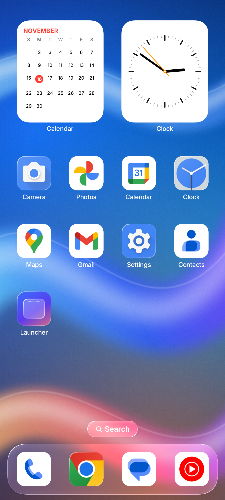

# Liquid Launcher

<p align="center"></p>

An Android home-screen launcher that recreates the **iOS 26 Home Screen with real Liquid Glass**, plus
**One UI 8** (Samsung) and **HyperOS / MIUI** (Xiaomi) styles you can switch between at any time.

Built with Kotlin and Jetpack Compose. Liquid Glass is rendered in real time by a custom AGSL lens shader
(Android 13+) that refracts the live UI behind it. It is not a blur-plus-transparency "glassmorphism" fake.

## Liquid Glass, not glassmorphism

Glassmorphism *scatters* light: it blurs the background and lays a translucent fill on top.
Apple's Liquid Glass *bends* light (WWDC25 "Meet Liquid Glass": *"it dynamically bends, shapes, and
concentrates light in real time"*). The shader in [`GlassShader.kt`](app/src/main/java/com/liquid/launcher/glass/GlassShader.kt)
follows that description:

| Apple's behaviour | How it's implemented |
| --- | --- |
| **Lensing** at the curved edge | The shape is treated as a slab with a circular bevel. Inside the bevel, the backdrop is sampled with an offset along the surface normal (`1 − √(1 − x²)` profile), so content wraps around the rim. |
| Bigger elements are "thicker": more lensing, softer scattering | Each style (`GlassStyle`) has its own `refraction`, `bevel` and `blur`. The dock and panels are thick, while pills and icons are thin. |
| Light dispersion | A small chromatic split of R/B along the rim. |
| **Specular highlights** travel along the edges and react to device motion | A rim highlight is strongest where the edge normal faces the light. A weaker highlight sits on the opposite edge. The light direction comes from the gravity sensor (`LightSource.kt`). |
| Adaptive tint; small elements flip light/dark, large ones don't | Average luminance under each element is sampled from the wallpaper (`LuminanceMap`). `resolveTint()` chooses the tint and lift. Panels/menus use `adaptive = false`. |
| Regular vs Clear variants, 35 % dimming over bright content (HIG) | `GlassVariant.REGULAR / CLEAR`. Clear adds the HIG dimming layer over bright content. |
| iOS 26.1 *Liquid Glass: Clear / Tinted* setting | `glassTinted` preference, which raises opacity everywhere. |
| Interaction: "illuminates from within… starting right under your fingertips", gel-like flex | `GlassGlow` drives a radial inner glow at the touch point. `glassPress` adds a springy scale-up. |
| Materialises by modulating lensing, not by fading | The `progress` input scales refraction and opacity together. |
| Concentric continuous corners | All shapes use superellipse corners. With n = 2.4 they match Apple's continuous-corner curve (fitted to < 0.1 % of the size). The shader SDF and the clip paths use the same geometry. |

**How it works:** the wallpaper, the home pages and the whole screen are each captured as a live
`GraphicsLayer` (a RenderNode). Each glass element draws the relevant capture by reference through a
`RenderEffect` chain of light blur → lens shader, so the glass always refracts the current frame.

On Android 9–12 the shader isn't available. The launcher falls back to frosted blur (12+) or tint (9–11)
with an approximate specular rim.

## Features

**iOS 26 style**
- 4×6 grid of continuous-corner (squircle) icons, each with a specular rim that follows the gyroscope
- Liquid Glass dock with even icon spacing
- "Search" glass pill above the dock that morphs into page dots while you swipe
- Icon appearance: **Default / Dark / Clear / Tinted**, light or dark tone, a tint hue slider, and small or large icons. All of this is in the *Customize* sheet, as on iOS 26.
- Jiggle mode with delete badges, the *Edit* menu (Add Widget, Customize, Settings) and *Done*
- Drag and drop with flow reordering. Hover over an icon to make a folder. Drag to the screen edge to change page. Drop into or out of the dock.
- Folders as glass tiles with a 3×3 preview. Opening one morphs the tile into a glass panel with a large title; you can rename it.
- Context menus as glass "bubbles" that pop out of the icon. They show the app's real shortcuts, Edit Home Screen, Share App and Remove App.
- iOS 26 alerts with stacked capsule buttons
- Spotlight on swipe down: search field at the bottom, Suggestions, Top Hit, and web/store search
- **App Library** as the last page, with category tiles and alphabetical search
- **Today View** as the first page, with widgets
- Built-in widgets that use real data: analog clock, calendar month, battery
- Real Android app widgets can also be added (AppWidgetHost)

**One UI 8 style:** rounder squircle icons, 4×5 grid, 5-icon dock without a platter, a home-dot page
indicator, swipe up for a paged app drawer, swipe down for the notification shade, a One UI long-press
popup with an icon row, edit mode that shrinks the pages and shows a bottom toolbar, and a big-header
settings layout.

**HyperOS / MIUI style:** its own icon shape, 4×6 grid, pill-dot indicator, a vertical drawer with
category chips and "Frequently used", and HyperOS-style dialogs.

**Shared:** notification badges (NotificationListener), Material You monochrome layers used for
Clear/Tinted icons, icon pack support, wallpapers (built in or from your photos), dark mode, reduce
transparency, app shortcuts, and uninstall.

## Icons: real app icons

Every icon is the **real icon of the app installed on your phone**, loaded from Android's `LauncherApps`.
The launcher keeps the adaptive-icon layers (background, foreground and monochrome) and re-masks them to
the selected style's shape. Dark, Clear and Tinted are built from those real layers, the way iOS 26
derives them.

This repo does **not** bundle Apple's, Samsung's or Xiaomi's icon artwork. That artwork is copyrighted and
can't be redistributed. To get exact iOS, One UI or HyperOS icon art, install any icon pack in the
standard ADW / Nova / Lawnchair format (`appfilter.xml`). There are many on the Play Store. Then pick it
in **Settings → Icons**. The launcher maps each app to the pack's drawable automatically.

The UI glyphs (search, share, trash and so on) are line icons drawn from scratch in the style of
SF Symbols. The wallpapers are generated procedurally. The UI font is **Inter** (SIL Open Font License,
see `LICENSE-Inter-OFL.txt`), the closest freely licensed face to SF Pro. One UI and HyperOS use the
device's system font, which is SamsungOne or MiSans on those phones.

## Build

Requirements: JDK 17+ and the Android SDK (platform 36).

```bash
./gradlew assembleDebug
```

```bash
adb install -r app/build/outputs/apk/debug/app-debug.apk
```

Press Home and choose **Liquid Launcher**, or open the **Launcher** settings app and tap
*Set as Home app*. Grant notification access in Settings if you want badges.

Gestures:
- **Swipe down:** Spotlight (iOS) or notification shade (One UI / HyperOS)
- **Swipe up:** app drawer (One UI / HyperOS)
- **Long-press an icon:** context menu; keep holding and move to drag
- **Long-press empty space:** edit mode
- **Swipe right from page 1:** Today View
- **Swipe left past the last page:** App Library

## Project layout

```
glass/       Liquid Glass engine: AGSL shader, backdrop capture, glass modifier, shapes, gyro light
theme/       ThemeSpec for iOS 26 / One UI 8 / HyperOS (grid, shapes, glass presets, behaviour)
data/        installed apps, layout model + persistence, flow packing, badges, prefs
icons/       real icon loading/masking (adaptive layers, monochrome), icon pack parser
wallpaper/   procedural wallpapers, photo import, luminance map
ui/          home screen, dock, folders, menus, Spotlight, App Library, drawer, widgets, settings
```

## Research sources

- Apple Human Interface Guidelines: [Materials](https://developer.apple.com/design/human-interface-guidelines/materials)
- WWDC25: [Meet Liquid Glass](https://developer.apple.com/videos/play/wwdc2025/219/) and [Say hello to the new look of app icons](https://developer.apple.com/videos/play/wwdc2025/220/)
- MacRumors: [iOS 26 Home Screen changes](https://www.macrumors.com/guide/ios-26-home-screen/)
- [LiquidGlassReference](https://github.com/conorluddy/LiquidGlassReference) (community notes)
